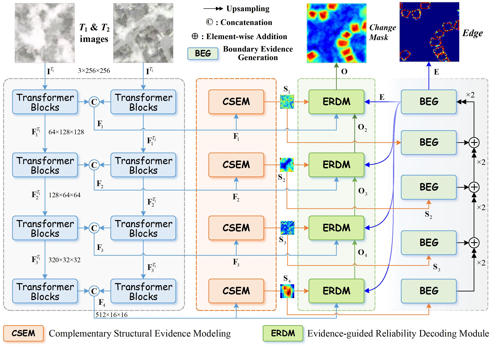

# Degradation-aware Structural-Frequency Learning for Robust Remote Sensing Change Detection


<p align="center">
  
  
  
  
</p>


## :pushpin: Introduction

This repository provides the implementation of a **Degradation-aware Structural-Frequency Learning (DSF-Net)** framework for **Robust Degraded Remote Sensing Change Detection**.

Cloud-fog degradation presents two related challenges for remote sensing change detection: it weakens structural evidence of genuine land-cover changes and introduces misleading responses in unchanged regions. DSF-Net coordinates **complementary structural evidence modeling** with **evidence-guided reliability decoding** to improve the discrimination of changed and unchanged areas under such interference.


<p align="center">
  
</p>

The architecture has two main components:

- **Complementary Structural Evidence Modeling (CSEM)** combines **Spatial Position Evidence (SPE)** with **Complementary Frequency Cues (CFC)**. Spatial references are integrated with wavelet-domain low- and high-frequency structural information rather than enhancing a single frequency component in isolation.
- **Evidence-guided Reliability Decoding (ERDM)** refines candidate change features through **Structural Evidence Calibration (SEC)**, **Cross-scale Semantic Consolidation (CSC)**, and **Frequency Reliability Screening (FRS)**.
---

## :rocket: Installation

```text
DSF-Net/
├── network/
│   ├── DSFNet.py
│   ├── CSEM.py
│   ├── BEG.py
│   ├── ERDM.py
│   ├── cd_tools.py
│   └── backbones/
│       └── pvtv2.py
├── utils/
│   ├── custom_transforms.py
│   ├── dataloader.py
│   ├── metrics.py
│   └── tools.py
├── pretrained_model/
│   └── pvt_v2_b2.pth
├── figures/
│   └── Framework.jpg
├── train.py
├── requirements.txt
└── README.md
```


```bash
git clone https://github.com/VisionVerse/DSF-Net.git
cd DSF-Net

conda create -n dsfnet python=3.10
conda activate dsfnet

pip install -r requirements.txt
```

Please install a PyTorch version compatible with your CUDA version.
A typical environment includes:

```text
python >= 3.10
torch >= 2.0
torchvision
timm
numpy
tqdm
Pillow
```


DSF-Net adopts **PVT-v2-B2** as the weight-sharing backbone. 
Please download the pretrained PVT-v2-B2 model and place it under:

```text
./pretrained_model/pvt_v2_b2.pth
```

The default path is:

```python
path = './pretrained_model/pvt_v2_b2.pth'
```


## :open_file_folder: Dataset Preparation

The new CFD RSCD datasets can be obtained from the [Cloud Drive](https://pan.jiangnan.edu.cn/link/AA0298DDB05F1E43F6A70CF8A4D664AAA3) [PW: RSCD].

Please organize the dataset as follows:

```text
CFD RSCD Dataset/
├── train/
│   ├── A/
│   ├── B/
│   └── label/
└── test/
    ├── A/
    ├── B/
    └── label/
```

Each sample contains:

- `A`: image at the first time point
- `B`: image at the second time point
- `label`: binary change mask

The ground-truth mask should follow:

```text
0: unchanged
1: changed
```

The benchmarks are referred to as `CFD-LEVIR-CD`, `CFD-LEVIR-CD+`, `CFD-SYSU-CD` and `HH` in the paper, and the same names are used for `--data_name`.

---

## :hourglass_flowing_sand: Training

Modify the dataset path and training configuration in `train.py`, then run:

```bash
python train.py \
  --data_name CFD-LEVIR-CD \
  --epoch 200 \
  --batchsize 32 \
  --trainsize 256 \
  --lr 1e-4 \
  --edge_weight 0.1
```

Main options:

```text
--data_name       dataset name
--epoch           number of training epochs
--batchsize       batch size
--trainsize       input image size
--lr              learning rate
--edge_weight     weight of edge supervision
```

The training logs will be saved to:

```text
./train_output/DSF-Net/{data_name}/
```


## :bar_chart: Testing

After training, run:

```bash
python test.py \
  --data_name CFD-LEVIR-CD \
  --model_path ./train_output/DSF-Net/CFD-LEVIR-CD/Seg_epoch_best.pth
```

The predicted change maps will be saved in the configured output directory.

---

## Acknowledgement
### :clap::clap::clap: Thanks to the authors of remote sensing change detection for their excellent works!
